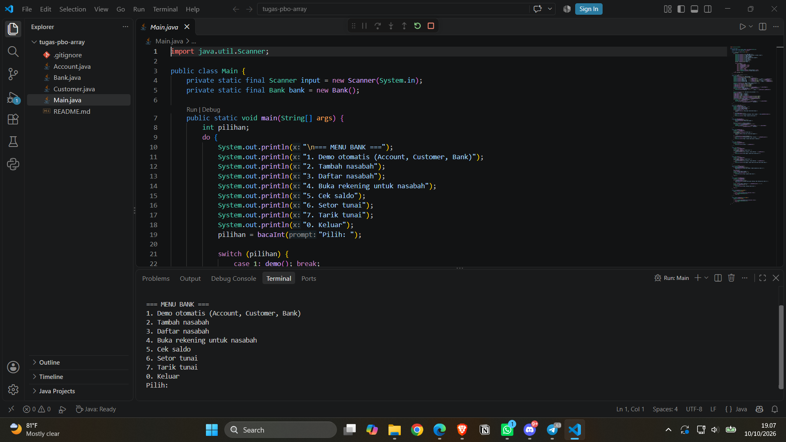
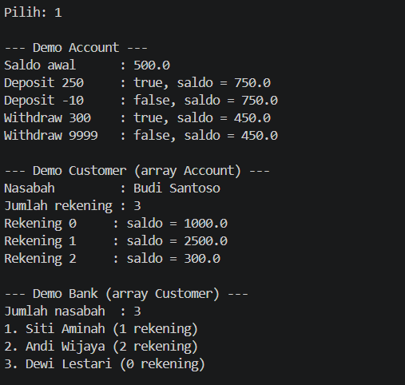
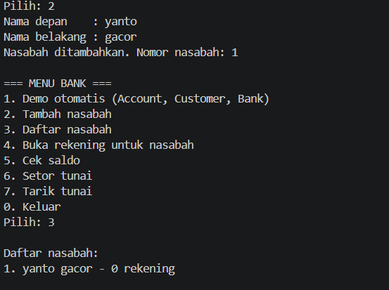
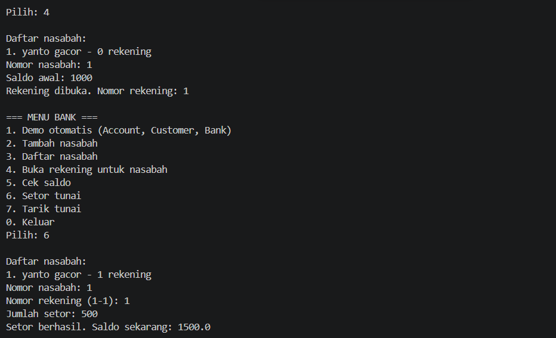
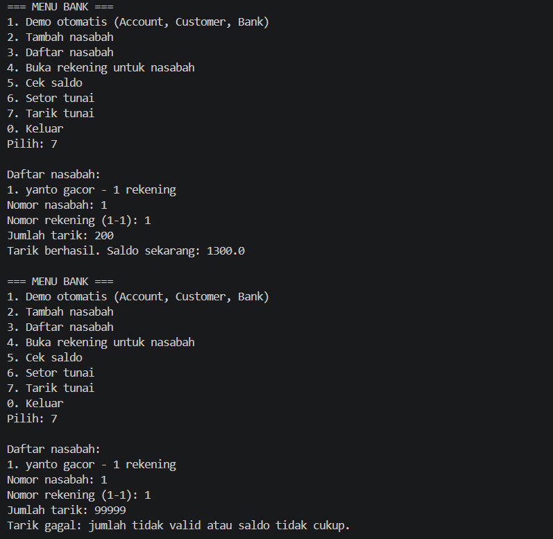

# Latihan PBO: Array dan ArrayList (Account, Customer, Bank)

**NIM:** F1D02510002
**Nama:** Ariyanta Nugraha Abdullah
**Mata kuliah:** Pemrograman Berorientasi Objek, Teknik Informatika, Universitas Mataram

## Isi Repositori

| File | Keterangan |
|---|---|
| `Account.java` | Rekening: atribut `balance` (private), `getBalance()`, `deposit()`, `withdraw()` |
| `Customer.java` | Nasabah: `firstName`, `lastName`, dan **array `Account[]`** (maksimal 5 rekening) |
| `Bank.java` | Bank: **array `Customer[]`**, `addCustomer()`, `getNumOfCustomers()`, `getCustomer()` |
| `Main.java` | Program utama berisi demo otomatis dan menu ATM sederhana |

## Relasi Antar Kelas

```
Bank  --(punya banyak)-->  Customer  --(punya banyak)-->  Account
```

## Penggunaan Array

- `Customer` menyimpan rekening dalam `Account[] accounts = new Account[5]`. Variabel `numberOfAccounts` mencatat index kosong berikutnya, sehingga `setAccount()` menaruh rekening di `accounts[numberOfAccounts++]` dan menolak jika sudah penuh.
- `Bank` menyimpan nasabah dalam `Customer[] customers` (kapasitas 20). `addCustomer()` membuat objek `Customer` baru dari nama depan dan belakang, menaruhnya di array, lalu menambah `numberOfCustomers`.
- Method `getAccount(index)` dan `getCustomer(index)` mengembalikan `null` jika index di luar jangkauan, supaya tidak terjadi `ArrayIndexOutOfBoundsException`.

## Aturan pada Account

- `deposit(amt)` berhasil (`true`) hanya jika `amt > 0`.
- `withdraw(amt)` berhasil (`true`) hanya jika `amt > 0` dan saldo mencukupi.

## Library Tambahan

Hanya memakai `java.util.Scanner` (bawaan Java) untuk membaca input pada menu. Tidak ada library eksternal.

## Cara Menjalankan

```bash
javac *.java
java Main
```

## Menu Program

| Menu | Fungsi |
|---|---|
| 1 | Demo otomatis Account, Customer, dan Bank |
| 2 | Tambah nasabah |
| 3 | Daftar nasabah |
| 4 | Buka rekening untuk nasabah |
| 5 | Cek saldo |
| 6 | Setor tunai |
| 7 | Tarik tunai |
| 0 | Keluar |

## Screenshot

### Menu utama


### Demo otomatis


### Tambah nasabah dan daftar nasabah


### Buka rekening, setor, dan cek saldo


### Tarik tunai (berhasil dan gagal karena saldo kurang)

